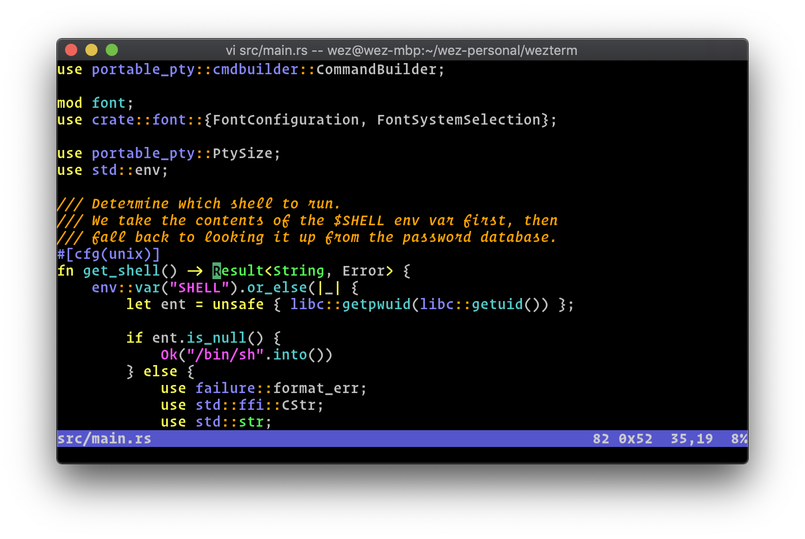

# Wez's Terminal

## This fork: Windows IME nightly

[Download the Windows x64 IME nightly](https://github.com/CoderTCY/wezterm/releases/tag/ime-nightly):
`WezTerm-nightly-setup.exe` (installer) or `WezTerm-windows-nightly.zip`
(portable), with SHA-256 checksums and `build-info.txt`. These are unofficial,
unsigned builds; Windows SmartScreen may warn.

The [IME nightly workflow](https://github.com/CoderTCY/wezterm/actions/workflows/wezterm-ime-nightly.yml)
lives on `main`. It runs on pushes to `main`, on manual dispatch, and daily at
00:17 UTC (08:17 China time; GitHub schedules may be delayed). It merges
upstream `main` into this fork with a normal merge, preserving the fork's
workflow and other commits. Do not force-reset/sync this fork to upstream:
that would discard fork-only commits, including this workflow.

The Windows runner builds the exact selected upstream commit plus the complete
`fix/8229-windows-ime-caret` branch ([upstream PR #8231](https://github.com/wezterm/wezterm/pull/8231)).
The patch is merged only in the temporary build checkout, never into fork
`main`. A runner-local `merge=union` rule preserves both sides of changelog
additions; any source-code conflict fails the build instead of silently
choosing one side. Packages use the upstream deployment script.

Successful builds update the rolling prerelease `ime-nightly`; the tag points
to the synchronized fork `main` commit, while `build-info.txt` records the exact
upstream, patch, and temporary merge SHAs. Unchanged upstream/patch SHAs skip
the build after a successful publication. Manual dispatch always rebuilds,
and failed builds are retried on the next trigger.

Automatic upstream sync requires the repository Actions secret
`UPSTREAM_SYNC_TOKEN`: a token allowed to push this repository's contents
**and workflow files**. Prefer a repository-scoped fine-grained token with
Contents and Workflows read/write; a classic token needs `repo` and `workflow`.
Renew/replace the secret when its token expires or is revoked. The secret is
available only to the sync step, not to patch code or compilation. Build and
release jobs use the automatic `GITHUB_TOKEN`. Sync commits include `[skip ci]`
to prevent recursive push builds; the current nightly run continues to build.

 *A GPU-accelerated cross-platform terminal emulator and multiplexer written by <a href="https://github.com/wez">@wez</a> and implemented in <a href="https://www.rust-lang.org/">Rust</a>*

User facing docs and guide at: https://wezterm.org/

*Screenshot of wezterm on macOS, running vim*

## Installation

https://wezterm.org/installation

## Getting help

This is a spare time project, so please bear with me.  There are a couple of channels for support:

* You can use the [GitHub issue tracker](https://github.com/wezterm/wezterm/issues) to see if someone else has a similar issue, or to file a new one.
* Start or join a thread in our [GitHub Discussions](https://github.com/wezterm/wezterm/discussions); if you have general
  questions or want to chat with other wezterm users, you're welcome here!
* There is a [Matrix room via Element.io](https://matrix.to/#/#wezterm:matrix.org)
  for (potentially!) real time discussions.

The GitHub Discussions and Element/Gitter rooms are better suited for questions
than bug reports, but don't be afraid to use whichever you are most comfortable
using and we'll work it out.

## Supporting the Project

If you use and like WezTerm, please consider sponsoring it: your support helps
to cover the fees required to maintain the project and to validate the time
spent working on it!

[Read more about sponsoring](https://wezterm.org/sponsor.html).

* 
* [Patreon](https://patreon.com/WezFurlong)
* [Ko-Fi](https://ko-fi.com/wezfurlong)
* [Liberapay](https://liberapay.com/wez)
